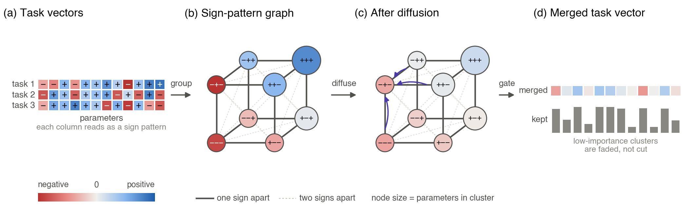

# SignGraph: Sign-Pattern Graph Diffusion for Model Merging

Official code for the paper *"SignGraph: Sign-Pattern Graph Diffusion for Model Merging"*.

📄 **Paper:** [OpenReview](https://openreview.net/forum?id=SV5VdwTd0q)



*Figure: (a) task vectors, (b) parameters grouped into sign-pattern clusters, (c) PageRank diffusion across the Hamming-distance graph, (d) soft-gated merged task vector.*

## Abstract

Model merging combines several task specific finetuned models into a single multitask model without retraining. Existing methods such as TIES, DARE, and DELLA resolve conflicts between task vectors through magnitude pruning and sign voting, and they treat each parameter largely in isolation. SignGraph first aligns task vectors whose signs are flipped relative to one another, then groups parameters by their N bit sign fingerprint across task vectors. It builds a Hamming distance graph over these clusters and runs personalized PageRank diffusion to propagate consensus between related sign patterns. A soft sigmoid gate, weighted by each cluster's size and mean magnitude and controlled by a single density parameter, then suppresses weak clusters. All other hyperparameters use fixed defaults, so density is the only value that needs tuning. We evaluate SignGraph against existing merging baselines on classification, code, and translation tasks, reporting retention relative to each individually finetuned model.

## Overview

SignGraph merges multiple task-specific fine-tuned models into a single multi-task model by:
1. Clustering parameters by their N-bit sign fingerprint across task vectors
2. Building a Hamming-distance graph over clusters
3. Running personalized PageRank diffusion to propagate consensus
4. Applying soft sigmoid suppression controlled by a density parameter

## Installation

```bash
pip install -r requirements.txt
```

Running the tests (from the repository root):

```bash
python -m pytest tests/
```

## Quick Start

### Using SignGraph directly

```python
import torch
from merge_methods import sign_graph

# task_tensors: list of N delta-weight tensors (theta_ft - theta_base)
# Each tensor has the same shape (e.g., a single layer's weights)
task_tensors = [delta_1, delta_2, delta_3, delta_4, delta_5, delta_6]
weights = torch.ones(6)  # equal weights
density = 0.05  # keep ~5% of parameter signal

merged = sign_graph(task_tensors, weights, density)
# merged has the same shape as each input tensor
```

### Running full experiments

```bash
# Edit configs/example.yaml with your adapter paths
python run_merging.py --config configs/example.yaml
```

`run_merging.py` loads the base model and adapters listed in the config, merges them with each method at each density, evaluates the merged models, and writes results to `output_dir` (default `results/`).

> **Scope:** this repository contains the merging algorithms and the evaluation code. The experiment infrastructure used for the paper's runs (cluster job orchestration, cloud storage, and experiment tracking) is not included.

## Methods Implemented

| Method | Paper | Key Idea |
|--------|-------|----------|
| **SignGraph** (ours) | This paper | Sign-pattern clustering + PPR diffusion |
| TIES | Yadav et al. 2023 | Magnitude prune + majority sign + disjoint merge |
| DARE-TIES | Yu et al. 2024 | Random dropout + rescale + TIES |
| DELLA | Shen et al. 2024 | Rank-based probabilistic pruning + L1 rescale |
| Consensus-TIES | — | Conflict-aware density allocation + TIES |
| Fisher Merging | Matena & Raffel 2022 | Fisher-information-weighted average |
| Task Arithmetic | Ilharco et al. 2023 | Weighted sum of task vectors |
| Simple Average | Wortsman et al. 2022 | Normalized weighted average |
| Model Breadcrumbs | Davari & Belilovsky 2023 | Outlier + small-magnitude pruning |

## Ablation Flags

`sign_graph` exposes the three ablations from the paper's ablation study. All default to off.

| Flag | Paper ablation | Effect |
|------|----------------|--------|
| `skip_graph=True` | Remove graph diffusion | Clustering and suppression only; no Hamming graph, PPR, or consensus shift |
| `hard_suppression=True` | Remove soft suppression | Hard thresholding instead of the sigmoid gate |
| `magnitude_weighted_edges=True` | Alternative graph | Edge weights scaled by cluster magnitude instead of pure Hamming distance |

## SignGraph Hyperparameters

| Parameter | Default | Description |
|-----------|---------|-------------|
| `density` (ρ) | tuned | Suppression threshold (only tunable param) |
| `correlation_threshold` (γ) | -0.7 | Sign flip detection threshold |
| `restart_prob` (α) | 0.3 | PPR restart probability |
| `num_diffusion_steps` (T) | 3 | Diffusion iterations |
| `consensus_weight` (β) | 0.3 | Consensus shift strength |
| `max_hamming` | 2 | Max Hamming distance for edges |
| `steepness` (s) | 10 | Sigmoid steepness |

Only `density` requires tuning; all others use fixed defaults.

## File Structure

```
.
├── merge_methods.py    # SignGraph and the baseline merging algorithms (PyTorch only)
├── utils.py            # Helpers used by the merging methods
├── run_merging.py      # Full pipeline: load adapters, merge, evaluate
├── evaluate.py         # Task-specific evaluation (classification, code, translation)
├── configs/
│   └── example.yaml    # Example configuration
├── figures/            # Figures used in this README
├── tests/
│   └── test_merge_methods.py  # Each method runs; ablation flags change the output
├── requirements.txt    # Python dependencies
├── LICENSE             # MIT
└── README.md           # This file
```

`merge_methods.py`, `utils.py`, and `evaluate.py` sit at the top level because `run_merging.py` imports them by module name.

## Evaluation

Results are reported as **retention**: the ratio of the merged model's task performance to the individually fine-tuned model's performance.

```
retention_t = score_merged_t / score_individual_t × 100
```

A method "wins" a slot if it achieves the highest retention across all methods and densities for that model-task pair.

## Citation

```bibtex
@inproceedings{signgraph2026,
  title={SignGraph: Sign-Pattern Graph Diffusion for Model Merging},
  author={Paul Trust},
  year={2026}
}
```

## License

MIT. See [LICENSE](LICENSE).
